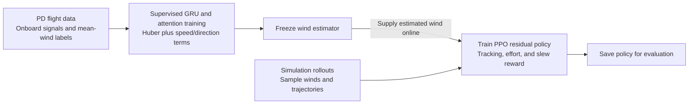
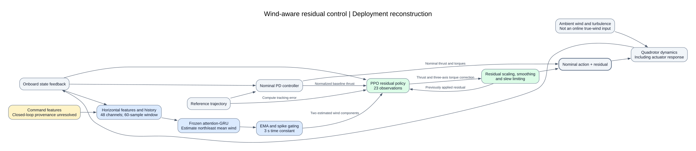

# Method framework: wind-aware residual control

[中文版本](wind-aware-rl-framework.md) · [Full close reading](wind-aware-rl-reading.en.md)

Reconstructed from Tasim and Sun's [arXiv:2607.01528v1](https://arxiv.org/abs/2607.01528v1) to demonstrate method-diagram generation. These are explanatory project reconstructions, not original paper figures or code-/experiment-validated implementations. Locations refer to the 30-page v1 PDF already read.

## 1. Training overview

Objectives appear only in training: component regression with speed/direction auxiliary terms for estimation, and a reward incorporating tracking error, residual magnitude, and slew for PPO. Labels are simulated mean wind; they are not supplied to the deployed policy. [pp.7–10, 16–17, Eq.2] This overview groups RL interaction and optimization into one stage rather than expanding every PPO update.

## 2. Deployment loop for fixed-altitude horizontal flight

```mermaid
flowchart LR
    accTitle: Wind-Aware Deployment Control Framework
    accDescr: The horizontal estimator uses onboard and command features to estimate mean wind. Filtered estimates inform PPO; nominal PD and filtered residual actions are added before the vehicle, with onboard-state feedback.
    reference["Reference trajectory"]
    state_signals["Onboard state feedback"]
    command_features["Command features<br/>Closed-loop provenance unresolved"]
    features["Horizontal features and history<br/>48 channels; 60-sample window"]
    estimator["Frozen attention-GRU<br/>Estimate north/east mean wind"]
    ema_filter["EMA and spike gating<br/>3 s time constant"]
    pd_controller["Nominal PD controller"]
    residual_policy["PPO residual policy<br/>23 observations"]
    action_filter["Residual scaling, smoothing<br/>and slew limiting"]
    action_sum["Nominal action + residual"]
    vehicle["Quadrotor dynamics<br/>Including actuator response"]
    ambient_wind["Ambient wind and turbulence<br/>Not an online true-wind input"]
    reference --> pd_controller
    state_signals --> pd_controller
    state_signals --> features
    command_features --> features
    features --> estimator
    estimator --> ema_filter
    ema_filter -->|"Two estimated wind components"| residual_policy
    state_signals --> residual_policy
    reference -->|"Compute tracking error"| residual_policy
    pd_controller -->|"Normalized baseline thrust"| residual_policy
    pd_controller -->|"Nominal thrust and torques"| action_sum
    residual_policy -->|"Thrust and three-axis torque correction"| action_filter
    action_filter --> action_sum
    action_filter -->|"Previously applied residual"| residual_policy
    action_sum --> vehicle
    ambient_wind --> vehicle
    vehicle --> state_signals
```

Solid edges indicate source-supported data or control relationships. The previous-action loop denotes history, not an instantaneous algebraic loop. This panel shows the horizontal estimator; the altitude-changing estimator uses 22 inputs and is not merged into the 48-channel horizontal model. [pp.9–12, 16]

**SVG preview:**

[Open SVG](wind-aware-rl-framework.en.svg) · [Graphviz source](wind-aware-rl-framework.en.dot)

## 3. Sources for modules and important edges

| Diagram content | Source | Interpretation boundary |
| --- | --- | --- |
| PD-generated supervised data; sensor and command features | pp.5–7, 9–10 | Whether deployment command features use baseline or final corrected commands is unclear; the diagram leaves this as a separate unresolved-provenance input |
| Mean-wind labels and supervised loss | pp.7–9 | Labels exclude instantaneous turbulence and appear only in training |
| 48 features, 60-sample window, frozen GRU | pp.8–10, 16 | Trailing averages use earlier history; the 6 s sequence is not all available memory |
| EMA and spike gating feed the policy | pp.14, 16 | A 3 s time constant is not a fixed 3 s pure delay |
| Policy receives state, wind, error, baseline thrust, and historical residual | p.16 | State components are grouped; observation-normalization details are omitted |
| Policy output, scaling, smoothing, and slew limit | pp.16–17 | Exact ordering of clipping and motor mixing needs code inspection |
| Direct PD branch plus residual addition | pp.15–17, together with p.8, Fig.1 | The direct nominal path is clarified from prose, not claimed as a line-by-line copy of the original figure |
| Disturbance, dynamics, and state feedback | pp.5–7, 16 | Feedback is a simplified bus, not noiseless ground-truth state; individual sampling and delay paths are omitted |
| PPO training after estimator freezing, with tracking/control reward | pp.16–17, Eq.2 | No source-supported joint end-to-end training edge is implied |

## 4. Boundaries retained in the diagram

- No simulated true wind, full-flight average, or future state is fed into the online policy.
- Wind-input-zeroing ablation is not depicted as independently retraining a method.
- Input rates, buffering, command-feature provenance, and constraint ordering have not been verified against implementation.
- The figure explains structure; it does not prove performance, mechanism, or stability. See the [close-reading example](wind-aware-rl-reading.en.md).

Copy and edit the Mermaid on this page. The SVG is exported from Graphviz reconstructed from the same deployment nodes and edges. The training overview remains Mermaid and is not part of the deployment SVG.
