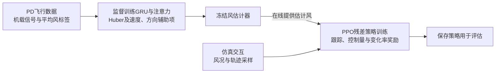
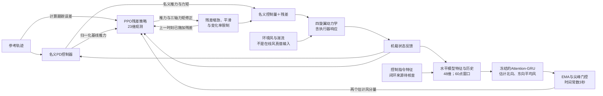
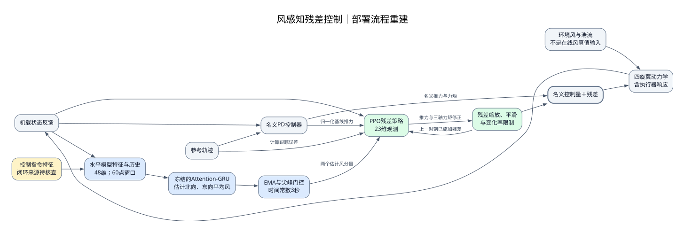

# 论文方法框架图：风感知残差控制

[English version](wind-aware-rl-framework.en.md) · [完整精读](wind-aware-rl-reading.md)

依据 Tasim 与 Sun 的 [arXiv:2607.01528v1](https://arxiv.org/abs/2607.01528v1) 重建，展示方法框架图功能。下图是本项目的解释性重建，不是论文原图，也没有通过代码或实验复现验证。页码指已阅读的30页v1 PDF。

## 1. 训练流程概览

训练目标只在训练图中出现：估计器采用分量回归损失及速度、方向辅助项；PPO依据跟踪误差、残差幅度和变化率等奖励训练。标签是仿真平均风；部署图不把它接入策略。【pp.7–10、16–17，式2】本概览把RL交互与更新合并为一个阶段，没有逐步展开PPO优化。

## 2. 定高水平飞行的部署闭环

实线表示原文支持的数据或控制关系；带“上一时刻”的回路表示历史动作，不是瞬时代数环。本图聚焦水平估计器；升降估计器采用22维输入，未与48维水平方案混成一个网络。【pp.9–12、16】

**SVG预览：**

[打开SVG](wind-aware-rl-framework.svg) · [Graphviz源文件](wind-aware-rl-framework.dot)

## 3. 模块与关键连接的原文依据

| 图中内容 | 来源 | 解读边界 |
| --- | --- | --- |
| PD生成监督数据；传感器和控制指令特征 | pp.5–7、9–10 | 部署时指令特征取自基线还是最终修正指令，未充分明确；图中单列输入并标注待核查 |
| 平均风标签及监督损失 | pp.7–9 | 标签不含瞬时湍流；只出现在训练流程 |
| 48维特征、60点历史窗口、冻结GRU | pp.8–10、16 | 历史均值本身可依赖更长过去，不能把6秒窗口当作全部记忆 |
| EMA及尖峰门控进入策略 | pp.14、16 | 3秒为时间常数，不表示固定3秒纯延迟 |
| 策略接收状态、风、误差、基线推力及历史残差 | p.16 | 图中合并状态分量，省略观测归一化细节 |
| 策略输出、缩放、平滑及变化率限制 | pp.16–17 | 各级限幅与电机混控的精确顺序需代码核查 |
| PD直接分支与残差相加 | pp.15–17；结合p.8，Fig.1 | 依据正文补清名义控制的直接路径，不声称逐线复制原图 |
| 环境扰动、动力学与状态反馈 | pp.5–7、16 | 反馈为简化总线，不表示无噪声真值状态；没有逐项绘制传感器采样与延迟 |
| 冻结估计器后训练PPO，奖励来自跟踪与控制项 | pp.16–17，式2 | 不存在本文证据支持的联合端到端训练箭头 |

## 4. 本图刻意保留的边界

- 没有把仿真风真值、全飞行平均值或未来状态接入在线策略。
- 没有把风输入置零的消融画成一项独立重训方法。
- 没有声称实际读取频率、缓冲更新、指令特征来源或约束执行顺序已通过实现核查。
- 图只解释结构，不证明性能、因果机制或稳定性；完整判断见[精读示例](wind-aware-rl-reading.md)。

读者可复制本页的Mermaid修改；SVG由同一部署节点与连线关系重建的Graphviz源文件导出。训练概览保留为Mermaid，不包含在部署SVG中。
